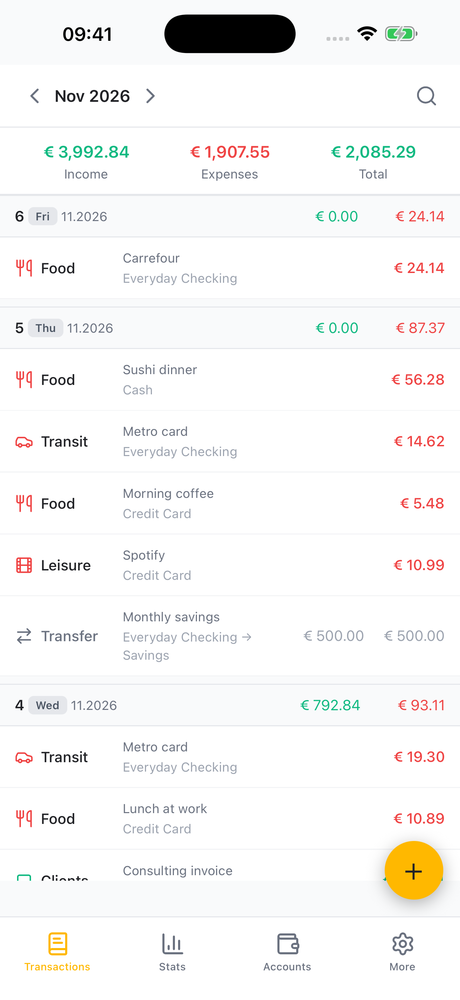
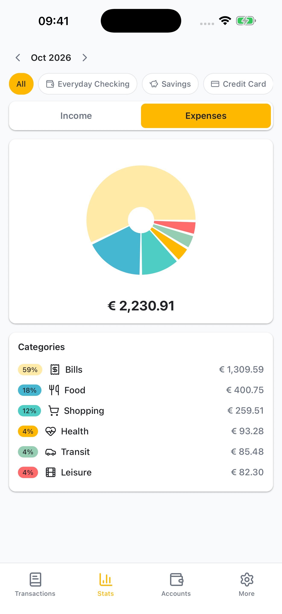
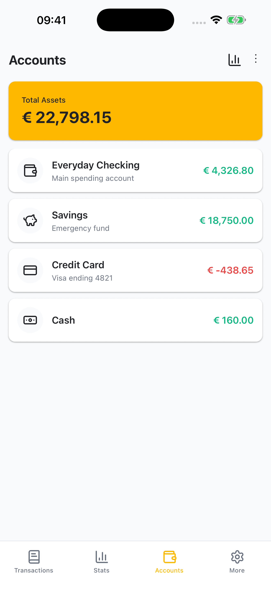
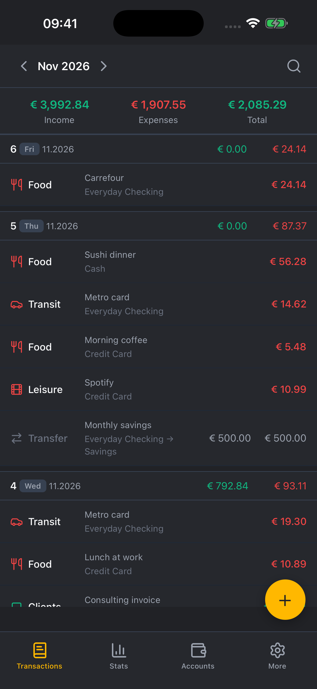
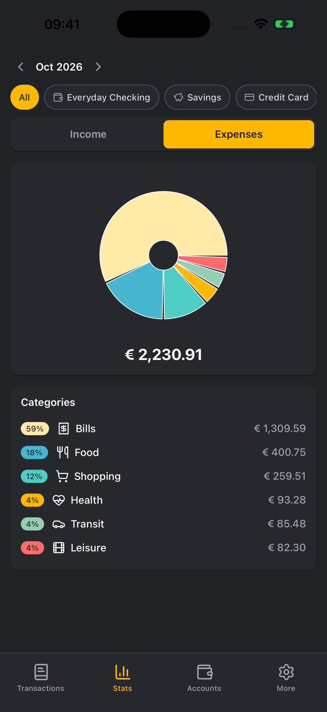
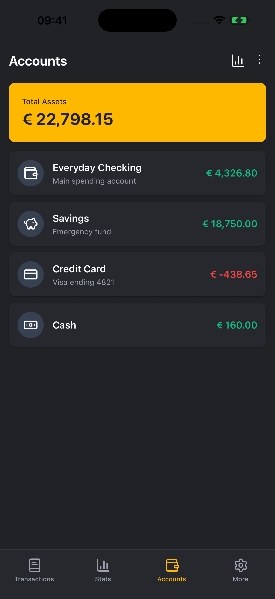
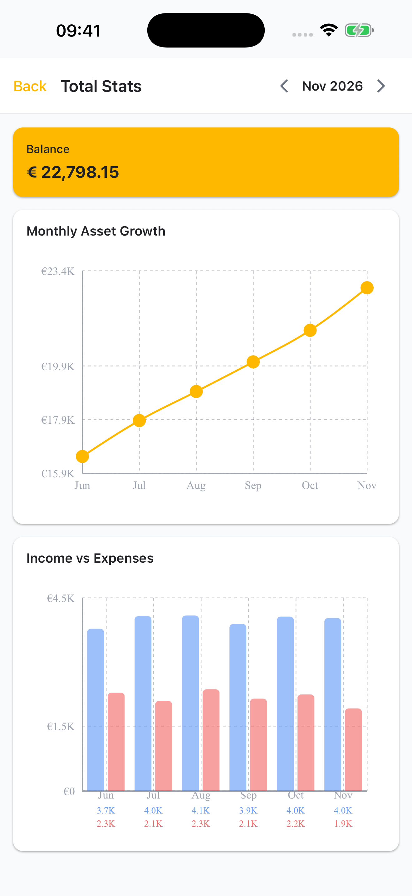
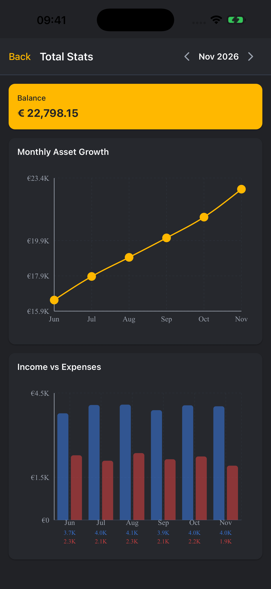

  

<h1 align="center">Cheddar</h1>

A private, offline-first personal finance tracker for Android.

Cheddar keeps your money data on your phone. No account, no cloud sync.
Everything lives in a local SQLite database that you can export and restore yourself.

## Screenshots

| | | |
| --- | --- | --- |
|  |  |  |
|  |  |  |
|  |  | |

## Features

- Transactions, accounts and categories
- Stats and lifetime totals
- Passcode lock with biometric unlock
- Encrypted backup export and import
- Optional premium upgrade, paid in Bitcoin
- English UI

## License

PolyForm Noncommercial License 1.0.0. See [LICENSE](LICENSE).

Required Notice: Copyright 2026 Juan Vilas
